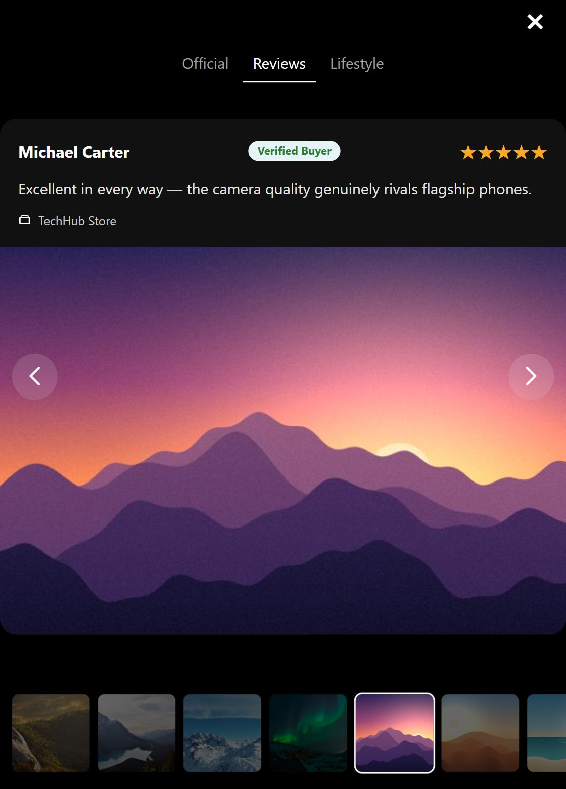

# Gallery Lightbox

A responsive, keyboard-accessible image gallery built with HTML, CSS and vanilla JavaScript on top of Swiper. A small autoplay preview opens a full-screen lightbox with category tabs, a synced thumbnail strip and a nested review slider.

**Live demo:** https://smah-ir.github.io/gallery-lightbox/

<p>
  
  
  
</p>

## Features

- Preview slider that opens the lightbox on the clicked image
- Three category tabs (Official, Reviews, Lifestyle) that jump to their group and stay in sync while you swipe
- Thumbnail strip synced with the main slider, with momentum scrolling
- Nested slider inside the Reviews tab: the arrows step through the review photos first, then move to the next slide
- Wrap-around navigation (from the last image back to the first)
- Keyboard support: Enter or Space to open, Esc to close, left and right arrows, focus trapped inside the lightbox and restored on close
- Preview autoplay pauses on hover and keyboard focus, and is turned off for users who prefer reduced motion
- Responsive layout from small phones to wide desktops

## Tech stack

HTML5, CSS3 (BEM naming, flexbox, grid), vanilla JavaScript (ES6+), Swiper 11 (loaded from a CDN)

## Run locally

```
git clone https://github.com/SMAH-ir/gallery-lightbox.git
cd gallery-lightbox
```

Open the folder in VS Code and start it with the **Live Server** extension. An internet connection is needed because Swiper is loaded from a CDN.

## Notes

The demo images are placeholder artwork. The Reviews tab is sample content, not real customer reviews.

## Author

Jason ([@SMAH-ir](https://github.com/SMAH-ir))